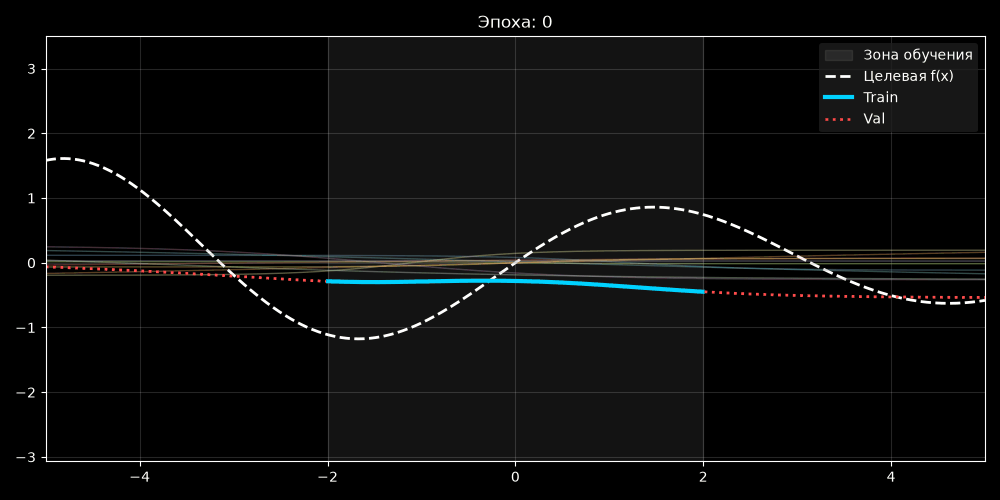
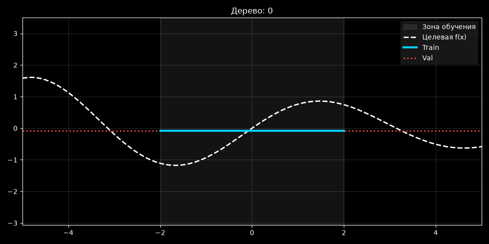

# Universal Approximator

Небольшое приложение на Streamlit, которое показывает теорему универсальной аппроксимации. Можно ввести любую одномерную функцию $f(x)$, выбрать нейросеть или градиентный бустинг и наблюдать, как отдельные нейроны или деревья складываются в заданную кривую. Готовую анимацию можно скачать в GIF.

Потыкать живое демо можно тут: [apps.financier.su/approx](https://apps.financier.su/approx/)

## Как это выглядит

Ниже пример для функции $f(x) = \sin(x) \cdot e^{-0.1 x}$ с обучением на отрезке $[-2, 2]$ и визуализацией на $[-5, 5]$.



_MLP на 10 нейронах с активацией `tanh`, 500 эпох: полупрозрачные кривые отдельных нейронов постепенно перестраиваются и в сумме ложатся на целевую $f(x)$ внутри зоны обучения._



_Градиентный бустинг на 60 деревьях глубины 3: начиная со среднего по обучающей выборке, каждое новое дерево добавляет ступеньки и уточняет приближение._

Важный момент, который хорошо видно на обеих гифках: за пределами зоны обучения _(там прогноз нарисован красным пунктиром)_ модель не подстраивается под функцию. У нейросети кривая продолжается, а бустинг вообще выходит на константы, потому что деревья решений не умеют экстраполировать за границы обучающей выборки.

## Что можно покрутить

Все настройки лежат в боковой панели:

- **Алгоритм:** однослойная нейросеть (MLP) или градиентный бустинг.
- **Функция $f(x)$ и сетка:** формула парсится через SymPy (поддерживаются `sin`, `cos`, `exp`, `log`, `sqrt`, `abs`, степень через `^`, константы `pi`, `e`, `tau` и привычные русские обозначения вроде `tg`, `arcsin`, `ln`), число точек сетки - от 100 до 2000.
- **Диапазоны:** границы зоны визуализации и зоны обучения (вторая должна лежать внутри первой).
- **Для нейросети:** число нейронов в скрытом слое (от 1 до 50), функция активации (`sigmoid`, `relu`, `tanh`, `gelu`, `leaky_relu`) и количество эпох.
- **Для бустинга:** количество деревьев (`n_estimators`), максимальная глубина (от 1 до 10) и режим отображения - текущее дерево без сжатия или история прошлых деревьев.
- **Обучение и анимация:** `learning_rate`, шаг сохранения кадров (`yield_every`) и длительность кадра в мс (она же задает скорость итогового GIF).

## Немного теории

Теорема универсальной аппроксимации утверждает, что нейросеть даже с одним скрытым слоем конечной ширины и нелинейной активацией может сколь угодно точно приблизить любую непрерывную функцию на компактном отрезке $[a, b]$. В коде это обычный MLP с одним скрытым слоем из $N$ нейронов, итоговый выход которого раскладывается в сумму их вкладов:

$$\hat{f}(x) = \sum_{i=1}^{N} w_i \cdot \sigma(v_i x + b_i) + c$$

У градиентного бустинга идея похожая, только вместо нейронов складываются решающие деревья. Стартуем с константы $F_0$ _(среднего по обучающей выборке)_, а затем на каждом шаге добавляем дерево $h_m(x)$, обученное на остатках предыдущей суммы:

$$F_M(x) = F_0 + \eta \sum_{m=1}^{M} h_m(x)$$

где $\eta$ - шаг обучения (`learning_rate`). На графике прямо видно каждый кирпичик этой суммы $:)$

## Как запустить

Я использую `uv` (требуется Python 3.11).

```bash
git clone https://github.com/financier-py/universal-approximator.git
cd universal-approximator

uv sync
uv run streamlit run app.py
```

## Структура проекта

```text
.
├── app.py                              # интерфейс Streamlit, сайдбар и экспорт в GIF
└── src/
    ├── parser.py                       # парсинг формулы через SymPy и компиляция в NumPy
    ├── data_builder.py                 # генерация сетки точек и разбиение на train/val
    ├── activations.py                  # словарь доступных функций активации
    ├── model.py                        # MLP с одним скрытым слоем и расчетом вкладов нейронов
    ├── nn_trainer.py                   # обучение нейросети (Adam, MSE) и выдача кадров
    ├── gdbt_trainer.py                 # обучение GradientBoostingRegressor и сбор вкладов деревьев
    ├── trainer_factory.py              # выбор нужного трейнера по параметрам
    ├── graphics.py                     # анимация на Plotly и рендер GIF через Matplotlib
    └── schemas/
        ├── experiment_params.py        # Pydantic-модель и валидация параметров эксперимента
        └── training_state.py           # структура кадра обучения (EpochState)
```
